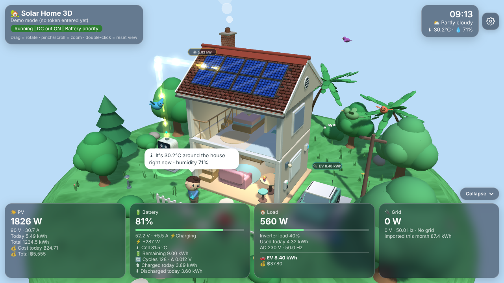

# Solar Home 3D



<p align="center"><a href="https://buymeacoffee.com/giize"></a></p>

An animated 3D solar-house dashboard for Home Assistant. Works with **any** inverter, battery, grid meter or EV charger: you pick the Home Assistant entities yourself. Anything you leave empty is simply not shown.

*Version 1.3.4 · 10 languages: ไทย, English, 中文, Tiếng Việt, Español, Deutsch, 日本語, 한국어, Français, Bahasa Indonesia*

## Features
- 3D house with PV, battery, load, grid (import / export) and EV energy-flow lines
- Entity picker with live values: PV (V/I/P, today, total, max power, cost), Battery (V/I/P, SoC, temperature, cycles), Load / inverter output, Grid import & export, EV, Weather
- Electricity rate and currency settings, cost per day / total
- Weather scene (rain, fog, snow, thunder, day/night) driven by your `weather.*` entity
- "Sunny", the little character, comments on what your system is doing
- Festivals that follow the real calendar (New Year, Chinese New Year, Halloween, Christmas, Songkran): decorations, fireworks, Santa's sleigh, ghosts and water splashes, and Sunny joins in. Pick one in the ⚙ menu to preview it any day, or switch festivals off
- Christmas: a snowman, a decorated tree, string lights along the eaves, gables and ridge, and glowing lanterns hanging from the front eave; Santa visits every 5 minutes, sneaks down the chimney and leaves a gift under the tree
- Songkran: every 5 minutes three cute neighbours come for either a water fight or a dance party in front of the speakers next to the mailbox (Sunny joins in), plus sand pagodas with flags
- Chinese New Year: a Chinese dragon chasing its pearl across the sky, fireworks by day and night, fountain sparklers and a hand-held sparkler for Sunny
- Halloween: Sunny dresses up as a vampire, bats instead of birds, a glowing pumpkin-head scarecrow with a crow, many styles of gravestones, and costumed kids coming for Trick or Treat every 5 minutes in the evening
- Neighbours drop by every 30 minutes to chat with Sunny; the festival banner on the roof only shows briefly when the app opens
- Random shooting stars on clear nights, every day of the year
- EV charging ring animation under the car, and a fountain in the fish pond
- Language picker (auto-detects from the browser)

## Installation (HACS)
1. HACS → ⋮ → **Custom repositories** → add this repository, category **Dashboard** (Lovelace plugin).
2. Install **Solar Home 3D** and reload the browser.
3. Add a card:
   ```yaml
   type: custom:solar-home-3d
   height: 640        # optional, px or CSS length
   ```
4. Open the card's ⚙ menu → **Entity settings** and pick your sensors.

The card re-uses Home Assistant's own login, no token is needed. The page loads three.js from cdnjs, so the browser needs internet access.

## Standalone use
`src/solar-home-3d.html` also runs on its own (e.g. in `/config/www`). Open it once as
`.../solar-home-3d.html?token=<long-lived-token>&url=http://homeassistant.local:8123`
and it remembers the connection. Without a token it runs in demo mode.

## Development
`python3 tools/build.py` regenerates `dist/solar-home-3d.js` from `src/solar-home-3d.html`. Bump `APP_VERSION` in the HTML for each release (shown in the settings menu), then tag the release with the same number.

---

## ภาษาไทย
แดชบอร์ดบ้านโซลาร์ 3D สำหรับ Home Assistant ใช้ได้กับ inverter ทุกยี่ห้อ เลือก Entity เองในเมนู "ตั้งค่า Entity" ช่องไหนเว้นว่างจะไม่แสดงผล ติดตั้งผ่าน HACS → Custom repositories → หมวด Dashboard แล้วเพิ่มการ์ด `type: custom:solar-home-3d`

## Support

If you like this project, you can support it: [Buy me a coffee](https://buymeacoffee.com/giize)
